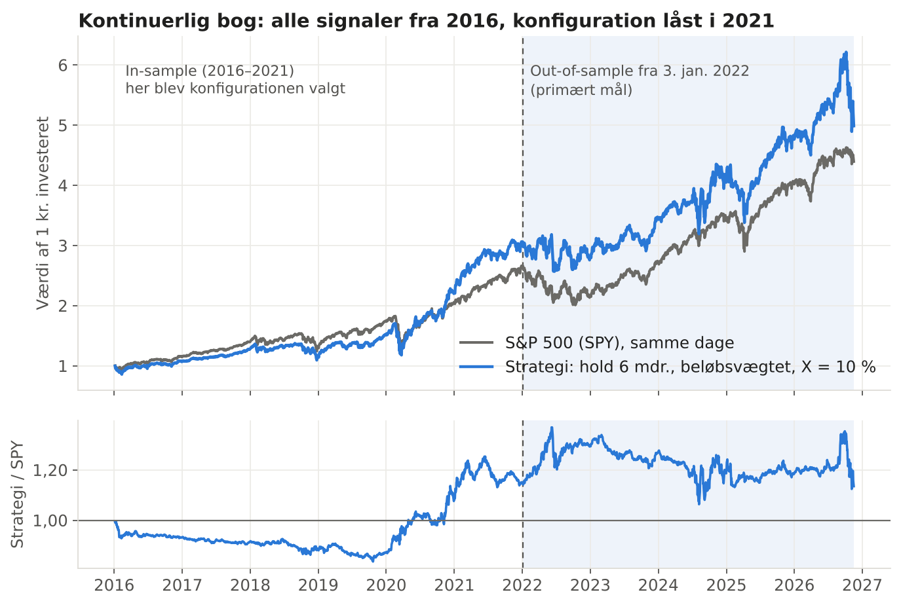
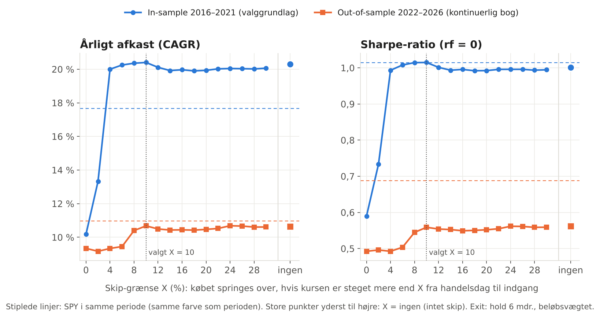
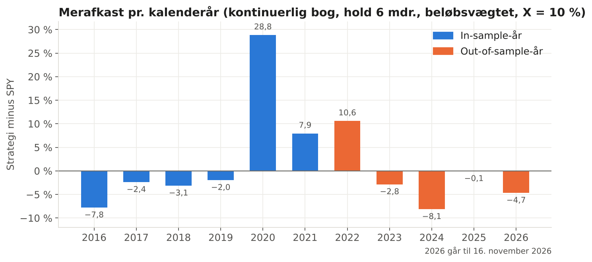

# Backtest v1: kan man tjene penge ved at kopiere Repræsentanternes Hus' aktiekøb?

17. november 2026. Kun Repræsentanternes Hus, indberetninger (PTR) 2016-01-01 til 2026-11-16, kurser til 2026-11-16.
Alle tal kommer fra `results/`, `review/` og `reports/data_quality_v1.md` og er kontrolleret med `review/check_report_numbers.py`.
Procenter er afrundet til én decimal og Sharpe-ratioer til to decimaler. Hvor forskellen er mindre end det, er der flere decimaler.

## Konklusion

Det forudregistrerede kriterium (højeste Sharpe i 2016–2021) peger på denne konfiguration: **hold hvert køb i 6 måneder, vægt efter det indberettede beløb, og spring købet over, hvis kursen er steget mere end X = 10 %** fra medlemmets handelsdag til vores indgang.

**Strategien slår ikke S&P 500 out-of-sample.** Det primære mål er en kontinuerlig portefølje, hvor konfigurationen blev låst i 2021, målt fra 3. januar 2022 til 16. november 2026. Her gav strategien +63,9 % mod SPY's +66,0 %, en Sharpe-ratio på 0,56 mod 0,69 og en årlig alfa på −0,3 % (Newey-West t = −0,06). Betaen var 1,10, og strategien havde højere volatilitet end markedet (22,9 % mod 17,4 %).

Allerede i perioden, hvor konfigurationen blev valgt, var der ingen reel fordel. Sharpe var 1,0147 mod SPY's 1,0142, og kun 2 af 136 kombinationer lå over SPY.

Skip-reglen har ingen robust værdi. Out-of-sample giver X = ingen (aldrig springe over) en Sharpe på 0,562 mod 0,559 for X = 10.

Valget af netop denne konfiguration er reelt uafgjort og skrøbeligt. X = 10 slår X = 8 med 0,0004 i Sharpe. Valget ændrer sig også, hvis man lægger de ikke-diskretionære køb tilbage (bias-review runde 2, F1), fjerner det største medlem eller fjerner den største 1 % af handlerne.

**Hvad betyder det for fonden?** Backtesten giver ikke grundlag for at investere penge efter denne strategi. Den svarer i praksis til at eje markedet med lidt højere risiko og samme eller lavere afkast. Den bør højst køre videre som paper trading eller som forskning, og kun hvis en ny regel er bygget alene på information, der var kendt på forhånd.

## Metode

**Data**
- Husets PTR-indberetninger 2016–2026: 7.004 indberetninger, hvoraf 5.312 har tekstlag og er læst af parseren.
- Aktie- og ETF-køb med `include_v1`: 20.567 rækker. Alle ejere er med (medlem, ægtefælle, barn).
- Kurser: dagskurser fra Alpaca (SIP-feed), justeret for split og udbytte.

**Indgang**
- Vi køber til **åbningskursen den første handelsdag efter indleveringsdatoen** (`filing_date`), altså tidligst når handlen er offentlig.
- Medlemmets egen handelsdato bruges aldrig til at handle på.

**Skip-regel**
- Stigningen beregnes som indgangskurs / lukkekurs på medlemmets handelsdag − 1.
- Købet springes over, **kun hvis kursen er steget mere end X**. Et fald fører aldrig til skip.
- Gitteret er X = 0, 2, …, 30 % og "ingen".

**Exit** (fire regler)
- hold i 3, 6 eller 12 kalendermåneder (lukkekurs);
- eller sælg, når medlemmet selv sælger samme ticker (åbningskurs dagen efter, at salget er indberettet).

**Vægtning**
- Lige vægt pr. handel, eller vægt efter midtpunktet af det indberettede beløbsinterval.
- Porteføljen er en kalendertids-portefølje: hver dag er afkastet gennemsnittet af de åbne positioner.

**Omkostninger**
- 0,1 % pr. handel, både ved køb og salg.
- SPY er sammenligningsgrundlag (behandlet som total return), uden omkostninger.

**In-sample og out-of-sample (snit ved 2021)**
- Signaler indleveret 2016–2021 er in-sample. Signaler indleveret fra 2022 er out-of-sample.
- Kriteriet blev skrevet i `src/backtest/config.py`, før resultaterne blev beregnet: blandt alle 4 × 2 × 17 = 136 kombinationer vælges den med højest årlig Sharpe (rf = 0) i in-sample-porteføljen, og den skal have mindst 200 handler.
- I udvælgelsen lukkes alle positioner tvangsmæssigt ved lukkekursen 31/12-2021, så ingen kurs efter 2021 påvirker valget.

**Primært out-of-sample-mål: den kontinuerlige portefølje**
- Porteføljen bygges af alle signaler siden 2016 med den låste konfiguration, og afkastet måles fra 2022-01-03.
- Positioner fra 2021, der stadig er åbne i 2022, er derfor med, ligesom de ville være i en rigtig fond.
- **Hvorfor dette mål?** Bias-reviewets runde 1 (F1, alvorlig) viste, at en portefølje, der starter tom 3/1-2022, blev domineret af ét medlems (Mark Green) energikøb i januar 2022. Det gav et kunstigt godt resultat.
- Porteføljen med kun 2022-signaler vises derfor kun som sekundært mål.

**Kontrol**
- Et uafhængigt bias-review i to runder har genberegnet alle 18.068 brugbare handler, porteføljen, alfa og årstabellen uden fejl.
- Dommen i runde 2 er "Ingen alvorlige fejl", men der er fund af middel og lille betydning (se Begrænsninger).

## Tabeller

### 1. Udvælgelse (in-sample, 2016-01-06 til 2021-12-31, alle positioner lukket 31/12-2021)

De øverste konfigurationer og den bedste X for hvert par af exit og vægtning. Til sammenligning vises deres out-of-sample-tal (kontinuerlig portefølje). De blev ikke brugt til valget.

| Exit | Vægtning | X | Handler | Afkast i alt | CAGR | Sharpe | Maks. fald | OOS afkast | OOS Sharpe |
|---|---|---|---:|---:|---:|---:|---:|---:|---:|
| **hold 6 mdr.** | **beløb** | **10** | 8.716 | **+203,9 %** | 20,4 % | **1,0147** | −31,0 % | +63,9 % | 0,56 |
| hold 6 mdr. | beløb | 8 | 8.205 | +203,3 % | 20,4 % | 1,0143 | −30,9 % | +61,9 % | 0,54 |
| hold 6 mdr. | beløb | 6 | 7.521 | +201,6 % | 20,2 % | 1,0078 | −30,9 % | +55,2 % | 0,50 |
| hold 6 mdr. | beløb | ingen | 10.697 | +202,3 % | 20,3 % | 1,0015 | −31,7 % | +63,7 % | 0,56 |
| hold 3 mdr. | beløb | 30 | 10.197 | +183,4 % | 19,0 % | 0,98 | −35,8 % | +88,3 % | 0,65 |
| hold 12 mdr. | beløb | 6 | 7.521 | +170,4 % | 18,1 % | 0,95 | −32,3 % | +64,3 % | 0,58 |
| hold 12 mdr. | lige | 10 | 8.716 | +131,3 % | 15,0 % | 0,85 | −37,2 % | +48,9 % | 0,57 |
| medlem sælger | lige | 10 | 8.716 | +125,5 % | 14,5 % | 0,85 | −36,3 % | +60,9 % | 0,67 |
| hold 6 mdr. | lige | 10 | 8.716 | +122,3 % | 14,3 % | 0,81 | −35,6 % | +49,7 % | 0,57 |
| hold 6 mdr. | lige | ingen | 10.697 | +122,3 % | 14,3 % | 0,80 | −36,1 % | +50,2 % | 0,57 |
| hold 3 mdr. | lige | ingen | 10.697 | +119,0 % | 14,0 % | 0,78 | −35,0 % | +45,8 % | 0,53 |
| medlem sælger | beløb | 10 | 8.716 | +104,6 % | 12,7 % | 0,75 | −38,0 % | +71,1 % | 0,69 |
| **SPY** | | | | **+164,7 %** | 17,7 % | **1,0142** | −33,8 % | +66,0 % | 0,69 |

- Kun 2 af 136 kombinationer har en in-sample-Sharpe over SPY's: X = 10 og X = 8 for hold 6 mdr. / beløb.
- Regressionsalfa for den valgte: +1,7 % om året, t = 0,55. Det er ikke signifikant.
- Out-of-sample har 14 af 136 kombinationer en højere Sharpe end SPY. De kunne ikke findes på forhånd: den bedste in-sample er ikke blandt dem.

### 2. Out-of-sample, primært mål: kontinuerlig portefølje, 2022-01-03 til 2026-11-16 (1.223 handelsdage)

| | Valgt: hold 6 mdr. / beløb / X = 10 | Samme, X = ingen | Lige vægt / X = ingen | SPY |
|---|---:|---:|---:|---:|
| Afkast i alt | +63,9 % | +63,7 % | +50,2 % | +66,0 % |
| CAGR | 10,7 % | 10,6 % | 8,7 % | 11,0 % |
| Volatilitet | 22,9 % | 22,6 % | 17,4 % | 17,4 % |
| Sharpe (rf = 0) | 0,56 | 0,56 | 0,57 | 0,69 |
| Maks. fald | −22,4 % | −22,2 % | −23,8 % | −24,5 % |
| Alfa pr. år (NW-t) | −0,3 % (−0,06) | −0,4 % (−0,08) | −1,6 % (−0,71) | |
| Beta | 1,10 | 1,10 | 0,96 | 1 |
| Tracking error | 12,8 % | 12,3 % | 4,8 % | |
| Information ratio | 0,07 | 0,06 | −0,43 | |
| Sharpe-forskel, Memmel z | −0,49 | −0,50 | −0,94 | |

- Alfa og beta kommer fra en daglig regression på SPY med Newey-West-standardfejl (5 lags).
- Betaen på 1,10 er signifikant over 1 (t = 2,56). Strategien tager altså lidt mere markedsrisiko end SPY.
- **Pr. handel** (handler indleveret 2022 og senere, valgt konfiguration): gennemsnitligt merafkast mod SPY i samme periode −1,0 % (−1,2 % for afsluttede handler). 44,7 % af handlerne slog SPY, og 59,7 % gav et positivt afkast.
- **Uden 2022:** måles fra 2023-01-03, giver den valgte +77,4 % (Sharpe 0,79) mod SPY's +102,9 % (1,29).

### 3. Sekundært out-of-sample-mål: kun signaler fra 2022, porteføljen starter tom (forvrænget, se review F1)

| | Valgt (X = 10) | Lige vægt / X = ingen | SPY |
|---|---:|---:|---:|
| Afkast i alt | +95,5 % | +55,7 % | +65,5 % |
| Sharpe | 0,71 | 0,61 | 0,68 |
| Alfa pr. år (NW-t) | +3,8 % (0,61) | −0,7 % (−0,28) | |

Dette mål ser bedre ud, fordi porteføljen i starten af 2022 består af få store energikøb i et år, hvor energi steg og SPY faldt. Det er ikke det resultat, en rigtig fond ville have fået.

### 4. Merafkast pr. kalenderår (kontinuerlig portefølje, valgt konfiguration)

| År | Periode | Strategi | SPY | Strategi − SPY |
|---|---|---:|---:|---:|
| 2016 | in-sample | +6,7 % | +14,5 % | −7,8 |
| 2017 | in-sample | +19,4 % | +21,7 % | −2,4 |
| 2018 | in-sample | −8,1 % | −5,0 % | −3,1 |
| 2019 | in-sample | +29,2 % | +31,1 % | −2,0 |
| 2020 | in-sample | +47,3 % | +18,5 % | +28,8 |
| 2021 | in-sample | +36,6 % | +28,6 % | +7,9 |
| 2022 | out-of-sample | −7,6 % | −18,2 % | +10,6 |
| 2023 | out-of-sample | +23,3 % | +26,2 % | −2,8 |
| 2024 | out-of-sample | +16,8 % | +24,9 % | −8,1 |
| 2025 | out-of-sample | +17,7 % | +17,7 % | −0,1 |
| 2026 (til 16/11) | out-of-sample | +4,7 % | +9,4 % | −4,7 |

Strategien slog SPY i 3 af 11 år. Forspringet in-sample kommer næsten kun fra 2020, og out-of-sample kun fra 2022.

### 5. Robusthed af valget

| Variant | Valgt konfiguration | In-sample Sharpe (SPY 1,014) | OOS afkast / Sharpe (SPY +66,0 % / 0,69) |
|---|---|---:|---:|
| Forudregistreret (basis) | hold 6 mdr. / beløb / 10 | 1,015 | +63,9 % / 0,56 |
| Uden in-sample-topmedlem (Suzan DelBene) | hold 3 mdr. / beløb / 30 | 0,872 | +88,3 % / 0,65 |
| Uden in-sample top 1 % handler efter beløb | medlem sælger / lige / 10 | 0,847 | +60,5 % / 0,67 |
| Sharpe først målt fra 2017-01-03 (opvarmning) | hold 6 mdr. / beløb / 10 | 1,087 (SPY 1,007) | +63,9 % / 0,56 |
| Ikke-diskretionære køb lagt tilbage (review runde 2, F1) | hold 12 mdr. / beløb / 6 | 0,948 | +63,75 % / 0,586 |

**Koncentration** (valgt konfiguration):
- **Andel af beløbsvægten:** den største 1 % af handlerne har 32,3 % af vægten in-sample og 32,6 % out-of-sample.
- **Største medlem in-sample: Suzan DelBene, 19,0 % af vægten** (32 handler, mest ægtefællens MSFT). Uden hende falder in-sample-Sharpe fra 1,015 til 0,830.
- **Største medlem out-of-sample: Cleo Fields, 11,1 %.** Uden ham giver den kontinuerlige portefølje +57,8 % (Sharpe 0,53).

### 6. Følsomhed (valgt konfiguration)

| Variant | In-sample Sharpe | OOS afkast | OOS Sharpe |
|---|---:|---:|---:|
| Basis | 1,015 | +63,9 % | 0,56 |
| Uden handler med kendte kursfejl (DOW, AZN, NVS, DLPH, DDR, SRC, RTX, DD) | 1,026 | +63,7 % | 0,56 |
| Uden handler med dagsbevægelse > +100 % / < −50 % | 1,029 | +63,7 % | 0,56 |
| Uden handler med dagsbevægelse > +15 % / < −13 % (øvre grænse, fjerner også almindelige regnskabshop) | 1,061 | +102,2 % | 0,85 |
| Uden indgange i et senere kursstykke (mulig genbrugt ticker) | 1,016 | +64,0 % | 0,56 |
| Stresstest: alle afnoterede exits sat til −100 % | 0,944 | +49,8 % | 0,48 |

Variant 3 (15 %-grænsen) fjerner 2.686 af 14.738 handler. Den er udvalgt efter resultatet (de volatile aktier fjernes) og er derfor ikke en rimelig korrektion.

### 7. Afkast som funktion af X (hold 6 mdr., beløbsvægtet)

| X | In-sample handler | In-sample CAGR | In-sample Sharpe | OOS CAGR | OOS Sharpe |
|---|---:|---:|---:|---:|---:|
| 0 % | 4.057 | 10,2 % | 0,59 | 9,3 % | 0,49 |
| 2 % | 5.490 | 13,3 % | 0,73 | 9,2 % | 0,50 |
| 4 % | 6.671 | 20,0 % | 0,99 | 9,3 % | 0,49 |
| 6 % | 7.521 | 20,2 % | 1,01 | 9,4 % | 0,50 |
| 8 % | 8.205 | 20,4 % | 1,014 | 10,4 % | 0,54 |
| **10 %** | **8.716** | **20,4 %** | **1,015** | **10,7 %** | **0,56** |
| 12 % | 9.083 | 20,1 % | 1,00 | 10,5 % | 0,55 |
| 16 % | 9.535 | 20,0 % | 1,00 | 10,4 % | 0,55 |
| 20 % | 9.843 | 19,9 % | 0,99 | 10,5 % | 0,55 |
| 24 % | 10.022 | 20,0 % | 1,00 | 10,7 % | 0,56 |
| 30 % | 10.197 | 20,1 % | 0,99 | 10,6 % | 0,56 |
| ingen | 10.697 | 20,3 % | 1,00 | 10,6 % | 0,56 |
| SPY | | 17,7 % | 1,01 | 11,0 % | 0,69 |

- Fra X = 4 % og op er kurven flad i begge perioder.
- Kun meget stramme grænser (0–2 %) gør det tydeligt dårligere.
- At X = 10 vinder, skyldes forskelle i fjerde decimal.

### 8. Optælling

| Trin | Antal |
|---|---:|
| Aktie-/ETF-køb med `include_v1` | 20.567 |
| − short-relaterede | 67 |
| − identiske dubletter / samme handel i flere indberetninger | 150 / 4 |
| − ikke-diskretionære (udbyttegeninvestering 638, forvaltet af tredjemand 265, overførsel/selskabshandling 17, vesting/løn 9, automatisk plan 4) | 933 |
| − ingen kurs ved indgang (ingen symbolkobling 895, data starter senere 84, data slutter før 73, hul 10, ingen handel den dag 3) | 1.065 |
| − ingen brugbar referencekurs (fjernet for alle X) | 280 |
| **Brugbare signaler** (in-sample / out-of-sample) | **18.068** (10.700 / 7.368) |
| Valgt konfiguration, in-sample: sprunget over / handlet | 1.981 / 8.716 |
| Valgt konfiguration, OOS-signaler: sprunget over / handlet | 1.349 / 6.019 |
| Kontinuerlig portefølje: handler i alt / aktive i 2022–2026 | 14.738 / 6.816 |
| Afnoterede exits: udvælgelse / kontinuerlig portefølje | 75 / 120 |
| Åbne ved slut 2026-11-16 (vurderet til sidste lukkekurs) | 483 |
| Tvangslukket 31/12-2021 i udvælgelsen | 794 |
| Exits udskudt af et hul i kursdata (hold 6 mdr.) | 2 |

## Grafer

**(a) Værdien af den valgte konfiguration mod SPY i den kontinuerlige portefølje.** Det skraverede område er out-of-sample-perioden fra 3. januar 2022. Det nederste panel viser forholdet mellem strategi og SPY.

- Strategien ligger over SPY i hele out-of-sample-perioden. Det er et forspring, den fik i 2020–2021, altså in-sample.
- Fra 2022 er forholdet strategi/SPY næsten fladt, og det ender lavere, end det startede.

**(b) Årligt afkast og Sharpe som funktion af X** (hold 6 mdr., beløbsvægtet), in-sample og out-of-sample. X = ingen er vist for sig selv yderst til højre.

**(c) Merafkast pr. kalenderår.**

## Begrænsninger og datahuller

1. **Scannede indberetninger mangler.**
   - Omfang: 1.692 af 7.004 indberetninger (24,2 %) har intet tekstlag og er ikke med.
   - Fordeling: de er skævt fordelt mod 2016–2018 (315, 295 og 297 pr. år) og mod nogle af de mest aktive handlere, fx Harold Rogers (129), Michael McCaul (127) og Rohit Khanna (121).
   - Antal handler: en stikprøve af 14 filer giver et meget usikkert skøn på 8.000–98.000 handler. Selv det laveste skøn er over planens grænse på 5 %.
   - Det er ikke en tilfældig udeladelse.
2. **Senatet er ikke med.**
   - eFD-systemet blokerede automatisk adgang den 17/11-2026, og Senatet er udskudt.
3. **Survivorship.**
   - 1.065 køb uden kurs ved indgang er faldet ud, mest afnoterede selskaber. Det kan gøre resultatet for pænt.
   - Positioner i aktier, der afnoteres, lukkes til sidste lukkekurs. Det er optimistisk ved konkurs, fx SIVB, der lukkes til 106,04 den 9/3-2023, selvom aktien blev næsten værdiløs.
   - Stresstesten med −100 % på alle afnoterede exits sænker out-of-sample til +49,8 % (Sharpe 0,48).
4. **Udbyttejusterede kurser i skip-reglen.**
   - "Stigningen" er en total-return-stigning. Et lille kursfald hen over en udbyttedag kan derfor se ud som en stigning.
   - Ved X = 10 kan op til 403 in-sample- og 268 out-of-sample-skip (ud af 1.981 og 1.349) vende ved et udbytte på højst 2 %.
   - Ujusterede kurser findes ikke i data (review F7 / runde 2 F4).
5. **Sharpe er beregnet med rf = 0.**
   - Absolutte Sharpe-ratioer er for høje i 2023–2026.
   - Da strategien er mere volatil end SPY, ville en positiv rente øge SPY's forspring en smule.
6. **Tickerskift behandles som afnotering.**
   - 34 sandsynlige navneskift (fx FB→META, SQ→XYZ, UTX→RTX) lukker positionen ved det gamle navns sidste kurs.
   - For den valgte konfiguration rammer det 18 handler, med blandet fortegn og lille effekt.
7. **Hul-reglen kigger frem.**
   - Om et langt hul i kursdata afslutter et kursstykke, afgøres af den senere genoptagelseskurs og af hullets længde.
   - Det har ingen effekt på hold 6 mdr. (review runde 2, F2).
8. **Filteret for ikke-diskretionære køb er skrevet efter runde 1.**
   - Filteret bruger kun indberetningens egen tekst, så der er intet look-ahead. Men det blev skrevet efter at have set resultaterne fra runde 1, og effekten er gunstig.
   - De 262 fjernede in-sample-rækker havde klaret sig dårligt. Uden filteret er in-sample-Sharpe for den valgte 0,930 og ikke 1,015, og kriteriet vælger hold 12 mdr. / beløb / X = 6.
   - Kategorien "forvaltet af tredjemand" fjerner alle Jefferson Shreves 189 "Portfolio Rebalance"-køb og løfter det primære out-of-sample-resultat fra +61,9 % til +63,9 % (review runde 2, F1).
   - Konklusionen om, at strategien ikke slår SPY, holder i alle varianter.
9. **Koncentration i få medlemmer og handler.**
   - Beløbsvægtningen giver den største 1 % af handlerne omkring en tredjedel af vægten.
   - DelBenes ægtefælles MSFT-køb (mønster som vesting) bestemmer en stor del af in-sample-resultatet.
10. **Tidligere udforskende backtests (F8).**
    - 2021–2026 var allerede undersøgt i tidligere backtests (`README.md`, `backtest/`), før gitteret og kriteriet blev lagt fast.
    - Out-of-sample er derfor kun pseudo-out-of-sample.
    - Det kan ikke bevises udefra, at kriteriet blev skrevet først, fordi projektet ikke var under versionsstyring.
    - Desuden blev universet (dubletter, referencekurser, ikke-diskretionære) ændret efter runde 1 (runde 2, F5).
11. **Ejerfeltet i 2022-skabelonen** er forkert for ca. 561 handler (heraf ca. 348 i v1). Der står "self", hvor PDF'en siger ægtefælle, fælles eller barn. Det påvirker ikke v1, fordi alle ejere er med.
12. **Ændringsindberetninger uden fundet original** (324 rækker) kan ikke markeres som dubletter og kan tælle dobbelt.
13. **Mindre forhold** (review runde 1 F9 og F12, runde 2 F6):
    - Porteføljekonstruktionen giver gratis rebalancering, så omkostningerne er undervurderet med ca. 0,1–0,2 % om året.
    - 17 køb, som medlemmet senere slettede, ville være blevet handlet live.
    - 150 identiske rækker er fjernet som dubletter, men kan være ægte gentagne køb.

## Afvigelser fra planen

- **Downloads:** hentningen af indberetninger og kurser blev kørt fra brugerens egen terminal, fordi Claudes miljøer ikke kan nå House Clerk og Alpaca. Kilderne er de samme som i planen.
- **Model:** Fable 5.2 kræver forbrugskreditter. Efter brugerens valg overtog Opus backtesteren og bias-kontrollen.
- **Stikprøve af scannede filer:** den blev stoppet efter 14 af 20 filer af samme grund.
- **Bias-review:** det blev begrænset til 2 runder efter brugerens valg (17/11-2026).
- **Senatet:** et forsøg (`ingestion/collect_senate_raw.py`) blev udskudt, da eFD blokerede automatisk adgang den 17/11-2026.

## Næste skridt

1. **Senatet via en anden kilde.** Det skal aftales med brugeren først (kilde, vilkår og pris).
2. **De scannede indberetninger.** Brugeren skal beslutte, om ca. 6.600 sider skal læses, og med hvilken model. Derefter køres backtesten igen med samme kriterium for at se, om konklusionen holder.
3. **En strategi for valg af medlemmer, der kun bruger tidligere information.** Fx rullende rangering af medlemmer efter deres afsluttede handler, med et nyt kriterium låst i git, før der regnes.
4. **Tekniske rettelser**, før noget nyt testes:
   - ikke-diskretionær-filteret med kun briefens kategorier som hovedtilfælde;
   - kæder for tickerskift;
   - en rentekurve til Sharpe;
   - ujusterede kurser til skip-reglen.
