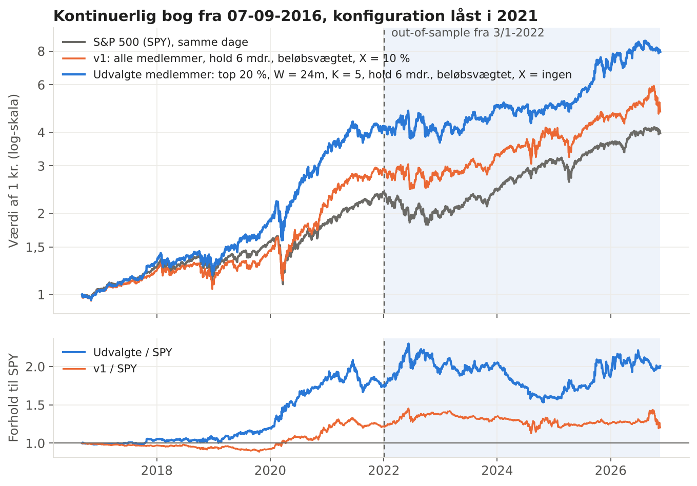
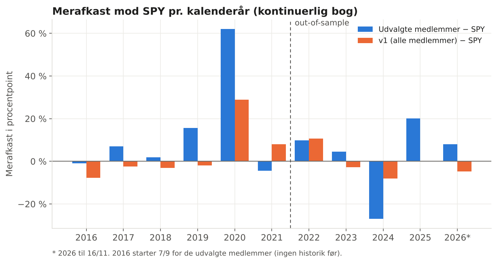

# Opfølgning: kan man slå S&P 500 ved kun at kopiere medlemmer med god historik?

17. november 2026. Samme data og regler som backtest v1 (Repræsentanternes Hus, PTR 2016-01-01 til 2026-11-16).
Alle tal kommer fra `results/member_selection/`. Metode og fortolkninger står i `results/member_selection/ASSUMPTIONS.md`.

## Konklusion

**Nej. Der er ingen troværdig evidens for, at det virker.** Medlemsudvælgelse ser bedre ud end v1, men fordelen skyldes to medlemmer og vægtning efter beløb. Det er ikke en evne til at udvælge medlemmer.

1. **Det forudregistrerede valg** (højeste in-sample-Sharpe blandt 128 kombinationer) blev: **top 20 % af medlemmerne efter krympet merafkast over de seneste 24 måneder, mindst 5 afsluttede handler, hold 6 mdr., beløbsvægtet, intet skip (X = ingen).**

2. **Out-of-sample** er resultatet pænt, men ikke signifikant. Målt på den kontinuerlige portefølje 2022-01-03 til 2026-11-16 blev det:

   | | Udvalgte medlemmer | v1 | SPY |
   |---|---:|---:|---:|
   | Afkast | +89,6 % | +63,9 % | +66,0 % |
   | Sharpe | 0,72 | 0,56 | 0,69 |

   - Alfa: +4,9 % om året, men t = 0,69 (p = 0,24).
   - Information ratio 0,23 og Sharpe-forskel z = 0,08.

3. **Merafkastet kommer fra to medlemmer.** Mark Green (energi-MLP'er købt 2021–22, 40 % af vægten) og Suzan DelBene (3 af ægtefællens MSFT-køb på 5–25 mio. $, 35 %) står for 75 % af vægten out-of-sample.
   - **Uden Mark Green** giver strategien +19,2 % (Sharpe 0,27) mod SPY's +66,0 %.
   - **Uden begge** giver den +14,1 %.
   - Det er samme energi-effekt i 2022, som bias-reviewet (runde 1, F1) fandt i v1. DelBenes rækker ligner vesting (v1, F5).

4. **Pr. handel klarer de udvalgte medlemmer sig *dårligere* end de fravalgte.** Det gælder out-of-sample: −1,8 % mod −0,9 % i merafkast over 6 måneder, t = −0,8. God historik forudsiger altså ikke gode næste handler. Det bekræfter det tidligere, uformelle fund.

5. **Lige vægtning, samme regel:** +29,6 % out-of-sample (Sharpe 0,37), langt under SPY. In-sample slår ingen af de 64 kombinationer med lige vægt SPY's Sharpe.

6. **Multiple testing:** den bedste in-sample-alfa (t = 1,84) består ikke Bonferroni for 128 test (kræver t > 3,36). Den deflaterede Sharpe for merafkastet mod SPY er 0,27 (skal være > 0,95).

**For fonden** giver testen ikke grundlag for at investere efter en medlemsudvælgelse. Strategien er reelt et koncentreret væddemål på nogle få medlemmers største køb. De største positioner er netop dem, der er mistænkt for ikke at være medlemmets egen beslutning.

**Risiko for overfitting:** høj. Ét tal (+89,6 %) ser godt ud, men næsten alt det, der burde følge med, hvis udvælgelsen virkede, er fraværende:
- statistisk signifikans;
- en effekt pr. handel;
- robusthed over for at fjerne ét medlem;
- en effekt ved lige vægtning.

Out-of-sample er desuden kun pseudo-out-of-sample. Perioden var allerede set i v1, og det var allerede kendt, at "alle medlemmer" ikke slår SPY.

## Metode

**Udgangspunkt:** alt er v1's motor, uændret. Det gælder indgang (åbning dagen efter indlevering), skip-regel, omkostninger (0,1 % pr. side), udelukkelser (ikke-diskretionære køb, dubletter, manglende referencekurs), regler for kurshuller og den kalendertids-portefølje, der bruges i v1. Det eneste nye er et filter på medlemmet.

**Historik for medlemmet (uden look-ahead).** For et køb med indgang dag *t* bruges kun medlemmets egne tidligere v1-brugbare køb, og kun hvis resultatet var kendt før *t*:
- Resultatet måles altid som "hold 6 mdr.", uanset strategiens egen exit. Det er lagt fast på forhånd.
- Et køb tæller kun, hvis exit-dagen ligger **før** *t*. Lukkekursen på exitdagen kendes først efter lukning, og vi køber til åbning.
- Ved afnotering tæller handlen først 64 handelsdage efter sidste kurs, når det er sikkert ud fra data, at aktien er væk.
- Åbne positioner tæller aldrig.
- Værdi pr. handel: nettoafkast minus SPY i samme periode.
- Vindue W: handler med exit inden for de seneste 24 måneder, eller hele historikken.
- Score = gennemsnit × n/(n + 10). Medlemmet skal have mindst K afsluttede handler.

**Udvælgelsesregel:** enten score > 0 eller top 20 % af de kvalificerede medlemmer efter score på dag *t*.

**Gitter:** W {24 mdr., alt} × K {5, 15} × regel {score > 0, top 20 %} × exit {medlem sælger, 3, 6, 12 mdr.} × vægtning {lige, beløb} × X {10 %, ingen} = **128 testede kombinationer**.

**Kriterium:** skrevet i `src/backtest/ms_config.py`, før noget resultat blev beregnet:
- højeste Sharpe (rf = 0) i 2016–2021;
- alle positioner tvangslukket 31/12-2021;
- mindst 200 handler.

**Kontrol mod look-ahead:**
- En test ændrer alle kurser fra dag *t* og frem og viser, at ingen beslutning på eller før *t* ændrer sig.
- Selve kørslen genberegner alle in-sample-beslutninger uden information efter 2021 og stopper, hvis blot én er anderledes. Alle 8 filtre er identiske.
- 19 tests i `tests/test_member_selection.py`. v1's 42 tests består uændret.

## Tabeller

### 1. Udvælgelse (in-sample, positioner lukket 31/12-2021)

De ti bedste efter Sharpe. Porteføljen starter først 2016-09-07, fordi ingen har historik før. SPY er målt på de samme dage.

| W | K | Regel | Exit | Vægt | X | Handler | Sharpe | SPY Sharpe | Alfa-t |
|---|---|---|---|---|---|---:|---:|---:|---:|
| **24 mdr.** | **5** | **top 20 %** | **hold 6 mdr.** | **beløb** | **ingen** | 1.354 | **1,24** | 1,00 | 1,84 |
| alt | 5 | top 20 % | hold 6 mdr. | beløb | ingen | 1.378 | 1,24 | 1,00 | 1,84 |
| 24 mdr. | 15 | top 20 % | hold 6 mdr. | beløb | ingen | 1.446 | 1,20 | 1,04 | 1,46 |
| alt | 15 | top 20 % | hold 6 mdr. | beløb | ingen | 1.543 | 1,19 | 1,04 | 1,46 |
| alt | 5 | top 20 % | hold 6 mdr. | beløb | 10 | 1.186 | 1,14 | 1,00 | 1,38 |
| 24 mdr. | 5 | top 20 % | hold 6 mdr. | beløb | 10 | 1.154 | 1,13 | 1,00 | 1,32 |
| alt | 15 | score > 0 | hold 6 mdr. | beløb | ingen | 2.506 | 1,11 | 1,00 | 1,22 |
| alt | 15 | top 20 % | hold 6 mdr. | beløb | 10 | 1.335 | 1,10 | 1,04 | 1,03 |
| alt | 5 | top 20 % | hold 12 mdr. | beløb | ingen | 1.378 | 1,08 | 1,00 | 1,05 |
| alt | 5 | score > 0 | hold 6 mdr. | beløb | ingen | 2.792 | 1,07 | 1,00 | 1,04 |

**Den valgte konfiguration in-sample:**
- afkast +319 % mod SPY's +139 %;
- CAGR 30,9 %, volatilitet 24,0 %, maks. fald −28,4 %;
- alfa +9,1 % om året (t = 1,84), beta 1,15, IR 0,94.

**Kombinationer over SPY's Sharpe in-sample:** 27 af 128. Alle er beløbsvægtede; ingen af de 64 med lige vægt slår SPY.

### 2. Out-of-sample, primært mål: kontinuerlig portefølje 2022-01-03 til 2026-11-16

| | Udvalgte medlemmer (valgt) | v1 (alle, X = 10) | Alle medlemmer, samme exit/vægt/X | Udvalgte, lige vægt | SPY |
|---|---:|---:|---:|---:|---:|
| Afkast i alt | **+89,6 %** | +63,9 % | +63,7 % | +29,6 % | **+66,0 %** |
| CAGR | 14,0 % | 10,7 % | 10,6 % | | 11,0 % |
| Volatilitet | 21,7 % | 22,9 % | 22,6 % | | 17,4 % |
| Sharpe | **0,72** | 0,56 | 0,56 | 0,37 | **0,69** |
| Maks. fald | −23,9 % | −22,4 % | −22,2 % | | −24,5 % |
| Alfa pr. år (NW-t) | +4,9 % (**0,69**) | −0,3 % (−0,06) | −0,4 % (−0,08) | (t −0,92) | |
| Beta | 0,89 | 1,10 | 1,10 | | 1 |
| Information ratio | 0,23 | 0,07 | 0,06 | | |
| Sharpe-forskel, Memmel z | 0,08 | −0,49 | −0,50 | | |

- **Pr. handel** (handler indleveret fra 2022): gennemsnitligt merafkast −1,5 %, og 45 % slog SPY. For v1 er tallene −1,0 % og 45 %.
- **Uden 2022** (målt fra 2023-01-03): +106,8 % (Sharpe 1,07) mod SPY's +102,9 % (1,29). Uden energiåret er strategiens Sharpe altså klart under SPY's.
- **Sekundært mål** (kun 2022-signaler, tom start): +118,1 % mod +65,5 %. Det er forvrænget af energikøb i starten af 2022, ligesom i v1.

### 3. Merafkast pr. kalenderår (kontinuerlig portefølje)

| År | Periode | Udvalgte | SPY | Udvalgte − SPY | v1 − SPY |
|---|---|---:|---:|---:|---:|
| 2016 (fra 7/9) | in-sample | +2,3 % | +3,3 % | −1,0 | (−7,8, hele året) |
| 2017 | in-sample | +28,7 % | +21,7 % | +6,9 | −2,4 |
| 2018 | in-sample | −3,2 % | −5,0 % | +1,8 | −3,1 |
| 2019 | in-sample | +46,7 % | +31,1 % | +15,6 | −2,0 |
| 2020 | in-sample | +80,5 % | +18,5 % | **+62,1** | +28,8 |
| 2021 | in-sample | +24,3 % | +28,6 % | −4,4 | +7,9 |
| 2022 | out-of-sample | −8,3 % | −18,2 % | +9,9 | +10,6 |
| 2023 | out-of-sample | +30,7 % | +26,2 % | +4,5 | −2,8 |
| 2024 | out-of-sample | −2,2 % | +24,9 % | **−27,0** | −8,1 |
| 2025 | out-of-sample | +37,8 % | +17,7 % | +20,1 | −0,1 |
| 2026 (til 16/11) | out-of-sample | +17,4 % | +9,4 % | +8,0 | −4,7 |

Udsvingene er store. Ét år (2020) bærer in-sample, og 2024 viser −27 procentpoint. Den årlige tracking error er 15 %.

### 4. Hvem bliver udvalgt?

**Top 5 efter vægt** (valgt konfiguration):

| In-sample | Andel af vægt | Handler | | Out-of-sample | Andel af vægt | Handler |
|---|---:|---:|---|---|---:|---:|
| Suzan DelBene | **55,0 %** | 29 | | Mark Green | **39,7 %** | 75 |
| Mark Green | 26,5 % | 170 | | Suzan DelBene | **35,3 %** | 3 |
| Greg Gianforte | 3,8 % | 52 | | Tim Moore | 4,3 % | 56 |
| Bradley Schneider | 2,4 % | 12 | | Maria Elvira Salazar | 3,4 % | 74 |
| Josh Gottheimer | 2,4 % | 237 | | Josh Gottheimer | 3,1 % | 152 |

- Den fulde top 15 står i `results/member_selection/selected_members.csv`.
- Kun 29 medlemmer (in-sample) og 27 (out-of-sample) bidrager overhovedet.
- Mark Greens out-of-sample-vægt er energi-MLP'er (ET, AM, ENLC, SHLX, USAC, PBFX, MPLX), købt juli 2021 til april 2022.
- DelBenes vægt er tre MSFT-rækker fra aug./sep. 2021, som holdes ind i 2022.

**Stabilitet.** Medlemmer, der var kvalificeret 1. handelsdag i hvert år:

| | 2017 | 2018 | 2019 | 2020 | 2021 | 2022 | 2023 | 2024 | 2025 | 2026 |
|---|---:|---:|---:|---:|---:|---:|---:|---:|---:|---:|
| Kvalificerede (af med historik) | 5/23 | 7/35 | 9/41 | 10/48 | 12/56 | 13/62 | 12/58 | 11/52 | 8/37 | 8/40 |
| Jaccard mod året før | 0,00 | 0,33 | 0,33 | 0,19 | 0,29 | 0,25 | 0,19 | 0,21 | 0,19 | 0,23 |

Udvalget skifter det meste fra år til år: typisk 20–30 % overlap.

### 5. Koncentration

| | In-sample | Out-of-sample |
|---|---:|---:|
| Største medlems andel af vægten | 55,0 % (DelBene) | 39,7 % (Green) |
| De 3 største medlemmers andel | 85,3 % | 79,3 % |
| Største 1 % af handlerne | 57,9 % | 45,6 % |
| Basis: afkast / Sharpe | +319 % / 1,24 | +89,6 % / 0,72 |
| Uden største medlem | +135 % / 0,85 (alfa-t −0,10) | **+19,2 % / 0,27** (alfa-t −0,92) |
| Uden de 2 største | +145 % / 0,90 | **+14,1 % / 0,23** |
| SPY | +139 % / 1,00 | +66,0 % / 0,69 |

Uden ét medlem ligger strategien under SPY i begge perioder.

### 6. Har god historik forudsigeværdi? (pr. handel, afsluttede 6-mdr.-handler)

| Filter | In-sample: udvalgte / fravalgte | Out-of-sample: udvalgte / fravalgte | OOS forskel (naiv t) |
|---|---:|---:|---:|
| **24 mdr., K 5, top 20 % (valgt)** | +0,9 % / −0,8 % | **−1,8 % / −0,9 %** | −0,9 pp (−0,80) |
| 24 mdr., K 5, score > 0 | −0,3 % / −0,6 % | −0,4 % / −1,3 % | +1,0 pp (1,10) |
| 24 mdr., K 15, top 20 % | +2,0 % / −0,9 % | −1,2 % / −1,1 % | −0,0 pp (−0,03) |
| 24 mdr., K 15, score > 0 | +0,3 % / −0,4 % | −0,5 % / −1,4 % | +0,9 pp (0,99) |
| alt, K 5, top 20 % | +1,4 % / −0,9 % | −0,9 % / −1,0 % | +0,1 pp (0,10) |
| alt, K 5, score > 0 | +0,0 % / −0,8 % | −0,9 % / −1,0 % | +0,1 pp (0,11) |
| alt, K 15, top 20 % | +1,3 % / −0,7 % | −1,3 % / −0,9 % | −0,4 pp (−0,41) |
| alt, K 15, score > 0 | +0,4 % / −0,6 % | −0,9 % / −1,1 % | +0,2 pp (0,26) |

- "Fravalgte" er medlemmer, der havde nok historik, men ikke blev udvalgt.
- In-sample ser de udvalgte lidt bedre ud. Out-of-sample forsvinder forskellen: den er mellem −0,9 og +1,0 procentpoint, og ingen t-værdi er over 1,1.
- Den naive t overvurderer signifikansen, fordi handlerne overlapper i tid.

### 7. Robusthed (hold 6 mdr., beløbsvægtet, X = ingen)

| Variant | Handler in-sample | In-sample Sharpe (SPY) | OOS afkast | OOS Sharpe (SPY 0,69) | OOS alfa-t |
|---|---:|---:|---:|---:|---:|
| **Valgt: 24 mdr., K 5, top 20 %** | 1.354 | 1,24 (1,00) | +89,6 % | 0,72 | 0,69 |
| 24 mdr., K 5, score > 0 | 2.710 | 1,07 (1,00) | +119,9 % | 0,90 | 1,22 |
| 24 mdr., K 15, score > 0 | 2.321 | 1,04 (1,00) | +118,1 % | 0,87 | 1,13 |
| 24 mdr., K 15, top 20 % | 1.446 | 1,20 (1,04) | +120,3 % | 0,82 | 1,02 |
| alt, K 5, score > 0 | 2.792 | 1,07 (1,00) | +103,2 % | 0,69 | 0,60 |
| alt, K 5, top 20 % | 1.378 | 1,24 (1,00) | +96,4 % | 0,62 | 0,52 |
| alt, K 15, score > 0 | 2.506 | 1,11 (1,00) | +122,7 % | 0,93 | 1,40 |
| alt, K 15, top 20 % | 1.543 | 1,19 (1,04) | +128,0 % | 0,91 | 1,33 |
| k_shrink = 0 (kun følsomhed) | 1.178 | 1,25 (1,00) | +165,0 % | 0,96 | 1,48 |
| k_shrink = 30 (kun følsomhed) | 1.527 | 1,22 (1,00) | +121,1 % | 0,88 | 1,19 |
| Samme filter, **lige vægt** | 1.354 | 0,99 (1,00) | +29,6 % | 0,37 | −0,92 |
| Sharpe først målt fra 2018 (opvarmning) | samme valg | 1,20 (0,89) | +89,6 % | 0,72 | 0,69 |

- **Naboerne** med beløbsvægt ligger alle over SPY i afkast og er ret ens. Ingen er signifikant: alfa-t ligger mellem 0,5 og 1,4.
- **Ensartetheden er ikke et tegn på robusthed.** Naboerne deler de samme to dominerende medlemmer, som kommer med under næsten enhver regel.
- **k_shrink** ændrer 480–641 beslutninger, men det er stadig de samme store positioner, der bærer resultatet. k_shrink påvirker kun top-20 %-reglen, fordi krympning ikke ændrer fortegnet på scoren.

### 8. Multiple testing

| | Antal / værdi |
|---|---:|
| Testede kombinationer | 128 (alle har mindst 200 handler in-sample) |
| Sharpe over SPY in-sample | 27 af 128 (alle beløbsvægtede) |
| Sharpe over SPY out-of-sample | 75 af 128 (55 af 64 beløbsvægtede, 20 af 64 lige vægt) |
| Afkast over SPY out-of-sample | 88 af 128 |
| Valgt: in-sample alfa-t, ensidig p | 1,84, p = 0,033 |
| Bonferroni-korrigeret p (×128) | 1,00 (kritisk t = 3,36) |
| Deflateret Sharpe for merafkast mod SPY, N = 128 / N = 8 | 0,27 / 0,74 (krav: 0,95) |
| Valgt: out-of-sample alfa-t, p (ét forudregistreret test) | 0,69, p = 0,24 |
| Bedste out-of-sample alfa-t af 128 (valgt bagefter) | 2,36, Bonferroni p = 1,00 |

- **Hvorfor slår så mange kombinationer SPY out-of-sample (75)?** De beløbsvægtede deler de samme koncentrerede positioner (Green, DelBene). De er altså ikke 75 uafhængige beviser.
- **Med lige vægt** slår kun 20 af 64 SPY.

### 9. Antal brugbare og udvalgte køb pr. år (valgt filter: 24 mdr., K 5, top 20 %)

| Indleveringsår | v1-brugbare køb | Medlem har ≥ 5 afsluttede handler | Udvalgt | Udvalgte medlemmer |
|---|---:|---:|---:|---:|
| 2016 | 1.070 | 242 | 88 | 5 |
| 2017 | 1.344 | 769 | 107 | 7 |
| 2018 | 1.571 | 1.029 | 147 | 8 |
| 2019 | 1.803 | 1.103 | 167 | 9 |
| 2020 | 2.721 | 1.944 | 339 | 9 |
| 2021 | 2.191 | 1.306 | 506 | 11 |
| 2022 | 1.151 | 1.091 | 178 | 10 |
| 2023 | 1.014 | 523 | 154 | 8 |
| 2024 | 935 | 720 | 69 | 8 |
| 2025 | 2.941 | 1.016 | 78 | 6 |
| 2026 | 1.327 | 1.139 | 141 | 4 |
| **I alt** | **18.068** | | **1.974** (1.354 in-sample, 620 OOS) | |

Alle 8 filtre er vist i `results/member_selection/eligibility_by_year.csv`.

## Grafer

**(a) Værdien af den valgte konfiguration mod SPY og v1** (kontinuerlig portefølje fra 2016-09-07, log-skala; out-of-sample er skraveret). Nederst ses forholdet til SPY.

- Næsten hele forspringet blev opbygget in-sample, især i 2020.
- Out-of-sample går forholdet til SPY fra 1,75 til 2,0, med et hop i 2022 (energi), et fald i 2024 og en stigning i 2025.

**(b) Merafkast pr. kalenderår.**

## Begrænsninger

1. **Pseudo-out-of-sample.** 2022–2026 var allerede undersøgt i v1, og det var kendt, at "alle medlemmer" ikke virker. Gitteret kom fra briefen, men selve spørgsmålet blev stillet efter at have set resultaterne.
2. **Ingen versionsstyring.** At kriteriet blev skrevet først, er dokumenteret med filtidspunkter (ms_config.py kl. 19:55, første resultat kl. 22:29) og en SHA-256. Det kan ikke bevises udefra.
3. **Alle v1's datahuller gælder også her:**
   - de scannede indberetninger (24 %) og Senatet mangler;
   - afnoteringer lukkes til sidste kurs;
   - tickerskift behandles som afnotering;
   - rf = 0.
4. **Ikke-diskretionære køb.** DelBenes umærkede MSFT-rækker (mønster som vesting) bliver ikke fjernet af v1's filter. Medlemsfiltret forstærker deres betydning fra 19 % (v1) til 55 % af vægten in-sample.
5. **Indbygget koncentration.** Beløbsvægtning og få udvalgte medlemmer giver en portefølje, hvor 1 % af handlerne har halvdelen af vægten. Resultatet kan ikke generaliseres til en fond, der spreder pengene.
6. **Lavere dækning i 2016.** Historikken starter tom i 2016, så de første måneder har få eller ingen udvalgte køb. Udvælgelsesperioden starter derfor 2016-09-07.

## Næste skridt

Ingen variant af medlemsudvælgelse bør køre som strategi på dette grundlag. Hvis det skal undersøges videre:
1. Gentag testen, når de scannede indberetninger er læst. Brug samme kriterium, uden at ændre noget.
2. Byg en bedre ikke-diskretionær markering (vesting/ægtefælles aktieløn), før beløbsvægtning bruges igen.
3. Brug lige vægt eller et loft pr. medlem (fx højst 10 % af porteføljen) som hovedtilfælde. Kun sådan kan man teste udvælgelse og ikke koncentration.
