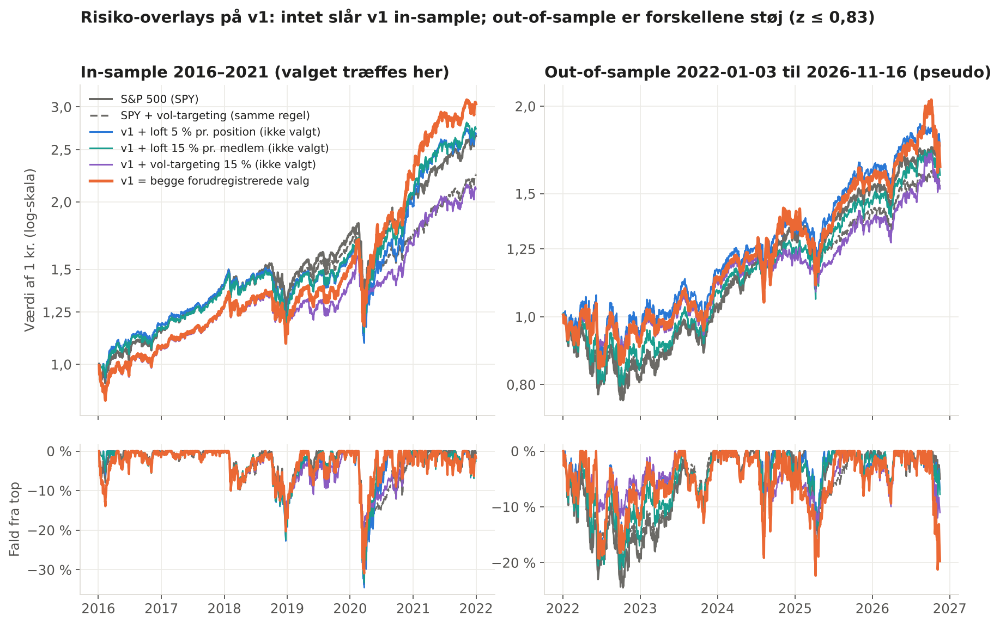

# Opfølgning: kan simple risiko-overlays forbedre v1?

18. november 2026. Samme data og samme låste signal som backtest v1 (Repræsentanternes Hus, PTR 2016-01-01 til 2026-11-16, hold 6 mdr., X = 10 %, 0,1 % pr. side).
Alle tal kommer fra `results/overlays/`. Metode og fortolkninger står i `results/overlays/ASSUMPTIONS.md`.
Procenter er afrundet til én decimal og Sharpe-ratioer til to decimaler, med flere decimaler hvor forskellen er mindre end det.

## Konklusion

**Nej. Ingen af overlayene forbedrer v1 på en måde, der kan påvises.** Det forudregistrerede kriterium vælger v1 selv. Det gælder både på Sharpe og som "risikoreduktions"-valg.

1. **In-sample (2016–2021, hvor valget træffes) slår ingen af de 17 overlays v1's Sharpe.**
   - v1 har 1,015. Det bedste overlay, beløbsvægt med loft på 15 % pr. medlem, har 1,000.
   - Kun v1 ligger inden for 1 procentpoint af v1's in-sample-CAGR (20,4 %). Det nærmeste overlay ligger på 18,3 %.
   - **Begge valg er derfor v1, og out-of-sample er resultatet uændret:** +63,9 %, Sharpe 0,56, volatilitet 22,9 %, beta 1,10, alfa-t −0,06. SPY gav +66,0 % og Sharpe 0,69.

2. **Out-of-sample ser flere overlays bedre ud end v1, men det er inden for støjen og fundet bagefter.**
   - 14 af 18 kombinationer har højere Sharpe end v1 i 2022–2026.
   - Bedst er **v1 med et loft på 5 % pr. position**: +75,6 %, Sharpe 0,72, volatilitet 18,5 %, maks. fald −18,9 %.
   - Men forskellen er ikke signifikant: Memmel z = 0,83 mod v1 og 0,18 mod SPY. Den deflaterede Sharpe mod v1 er 0,36 (kravet er 0,95).
   - In-sample var netop denne kombination *dårligere* end v1 (0,97 mod 1,01). Den kunne ikke være valgt på forhånd.
   - Rangkorrelationen mellem in-sample- og out-of-sample-Sharpe over de 18 er kun 0,38.

3. **Vol-targeting reducerer risikoen, men gør ikke noget, der er særligt for strategien.**
   - På v1 out-of-sample falder volatiliteten fra 22,9 % til 15,5 % og det maksimale fald fra −22,4 % til −15,1 %. Afkastet falder fra +63,9 % til +52,4 %, og Sharpe stiger fra 0,56 til 0,64.
   - **Samme regel på SPY giver Sharpe 0,70** (volatilitet 14,1 %, afkast +53,5 %). v1 med vol-targeting er stadig under både SPY og SPY med vol-targeting.
   - In-sample gør vol-targeting det modsatte: v1's Sharpe falder fra 1,01 til 0,95, og CAGR fra 20,4 % til 13,3 %. Overlayet var mest nedskaleret netop i genopretningen efter krakket i marts 2020.

4. **Hvorfor vender billedet fra in-sample til out-of-sample?**
   - v1's koncentration i få medlemmer og store handler betalte sig i 2020 (+47,3 % mod +25–30 % med loft) og i 2022 (energi). Den betalte sig ikke i 2023–2026.
   - Lofterne fjerner altså et væddemål, hvis retning ikke kan forudsiges. De tilfører ikke en evne.
   - Uden 2022 slår ingen af de viste varianter SPY: v1 med loft har Sharpe 1,07 mod SPY's 1,29 (tabel 3).

**For papirfonden: skift ikke.** Begrundelsen er:
- Det forudregistrerede valg er v1.
- At skifte til den kombination, der så bedst ud out-of-sample, er præcis det valg efter at have kigget, som protokollen skal forhindre. Forskellen kan heller ikke skelnes fra støj.
- Vol-targeting er en generisk risikoreduktion, som SPY får lige så meget ud af. Hvis man vil have mindre risiko, er det enklere at holde en mindre del af fonden i strategien.
- Papirfonden har i forvejen et loft på 10 % af egenkapitalen pr. position og et loft på 10 × basisstørrelsen (`live/strategy.json`). Den er altså ikke så ukoncentreret som v1's kalendertidsportefølje.
- Hvis man vil teste et positionsloft rent, skal det forudregistreres nu og måles fremadrettet, fx som en skyggeportefølje ved siden af papirfonden. Papirfondens låste regel ændres ikke.

**Risiko for overfitting:** lav for selve valget, fordi kriteriet valgte det uændrede v1. **Høj, hvis man tager udgangspunkt i out-of-sample-tabellen**, fordi den bedste af 18 er valgt bagefter, og hele 2022–2026 allerede var kendt (pseudo-out-of-sample).

## Metode

**Udgangspunkt.** v1's motor er uændret. Det gælder indgang (åbning dagen efter indlevering), skip ved stigning over 10 %, exit efter 6 måneder, 0,1 % pr. side og alle udelukkelser. Det er de samme 8.716 handler in-sample og 14.738 i den kontinuerlige portefølje i alle 18 kombinationer. Kun porteføljens vægte ændres.

**Kontrol.** Kombinationen beløb / intet loft / ingen vol-targeting genskaber v1's tal i `results/grid_summary.csv` med en afvigelse under 1e-9. Kørslen stopper, hvis den ikke gør.

**Gitteret** (3 × 3 × 2 = 18, skrevet i `src/backtest/overlay_config.py` kl. 10:21, før noget resultat blev beregnet):

| Dimension | Værdier |
|---|---|
| Vægtning (startbeløb pr. handel) | lige · beløb (v1) · √beløb |
| Loft (gælder hver dag) | intet · højst 5 % af porteføljen pr. position · højst 15 % pr. medlem |
| Vol-targeting | fra · til |

**Lofterne:**
- Hver dag beregnes de naturlige vægte, ligesom i v1. De bygger kun på gårsdagens lukkekurs og dagens køb.
- Vægte over loftet sættes til loftet, og overskuddet fordeles forholdsmæssigt på de øvrige positioner (eller medlemmer). Det gentages, til intet er over loftet.
- Er der for få positioner (under 20) eller medlemmer (under 7), står resten kontant til 0 %. Det sker kun i de første 18 handelsdage i januar 2016.
- Omfordelingen inden for porteføljen koster 0,1 % (konservativt). Det beløber sig til 0,01–0,08 % om året.

**Vol-targeting:**
- Eksponering = min(1; 15 % / realiseret volatilitet de seneste 63 handelsdage). Den måles kun på afkast til og med dagen før.
- Justeres dagligt, uden gearing. Resten står kontant til 0 %, fordi der ikke er en rentekurve i data. **Det straffer overlayet**, især i 2023–2026.
- 0,1 % i omkostning på ændringen i eksponering.
- Indtil der er 63 dages historik, er eksponeringen 1.

**Kriterier (forudregistreret):**
- **Primært valg:** højeste in-sample-Sharpe (2016–2021, alle positioner lukket 31/12-2021).
- **Risikoreduktions-valg:** laveste in-sample-volatilitet blandt kombinationer, hvis CAGR ligger inden for ±1 procentpoint af v1's.

**Sanity-tjek.** Samme vol-targeting-regel anvendt på SPY, så man kan se, om en gevinst bare er den generiske vol-targeting-effekt.

**Tests.** 27 nye tests i `tests/test_overlays.py`:
- lofter summerer til ≤ 1 og omfordeles;
- vol-targeting bruger kun fortiden (afkast fra dag *t* ændres, eksponeringen på *t* gør ikke);
- eksponering ≤ 1;
- omkostning på ændret eksponering;
- √-vægtning;
- intet loft = v1's portefølje præcist.

Alle tidligere tests består uændret (262), og ingen eksisterende fil er ændret (kontrolleret med SHA-256).

## Tabeller

### 1. Udvælgelse (in-sample 2016-01-06 til 2021-12-31, positioner lukket 31/12-2021)

| Vægtning \| loft \| vol-targeting | Afkast | CAGR | Volatilitet | Sharpe | Maks. fald | Beta | Sharpe fra 2/2-2016 |
|---|---:|---:|---:|---:|---:|---:|---:|
| lige \| intet \| fra | +122,3 % | 14,3 % | 18,7 % | 0,809 | −35,6 % | 1,01 | 0,904 |
| lige \| intet \| til | +72,9 % | 9,6 % | 13,7 % | 0,738 | −24,3 % | 0,68 | 0,869 |
| lige \| 5 % pr. position \| fra | +143,5 % | 16,0 % | 18,5 % | 0,898 | −35,6 % | 1,00 | 0,904 |
| lige \| 5 % pr. position \| til | +90,1 % | 11,3 % | 13,4 % | 0,867 | −24,3 % | 0,67 | 0,873 |
| lige \| 15 % pr. medlem \| fra | +137,3 % | 15,5 % | 18,4 % | 0,876 | −36,3 % | 1,00 | 0,883 |
| lige \| 15 % pr. medlem \| til | +86,8 % | 11,0 % | 13,4 % | 0,847 | −24,8 % | 0,67 | 0,855 |
| **beløb \| intet \| fra (v1, begge valg)** | **+203,9 %** | **20,4 %** | 20,3 % | **1,015** | −31,0 % | 1,07 | **1,107** |
| beløb \| intet \| til | +111,5 % | 13,3 % | 14,2 % | 0,954 | −19,8 % | 0,67 | 1,090 |
| beløb \| 5 % pr. position \| fra | +167,6 % | 17,9 % | 18,9 % | 0,966 | −34,6 % | 0,99 | 0,972 |
| beløb \| 5 % pr. position \| til | +96,8 % | 12,0 % | 13,7 % | 0,892 | −24,3 % | 0,66 | 0,898 |
| beløb \| 15 % pr. medlem \| fra | +173,4 % | 18,3 % | 18,5 % | 1,000 | −33,3 % | 1,00 | 1,009 |
| beløb \| 15 % pr. medlem \| til | +110,7 % | 13,3 % | 13,6 % | 0,985 | −22,9 % | 0,67 | 0,996 |
| √beløb \| intet \| fra | +128,3 % | 14,8 % | 18,8 % | 0,828 | −35,0 % | 1,01 | 0,923 |
| √beløb \| intet \| til | +73,8 % | 9,7 % | 13,7 % | 0,741 | −24,1 % | 0,68 | 0,873 |
| √beløb \| 5 % pr. position \| fra | +150,4 % | 16,6 % | 18,6 % | 0,918 | −35,0 % | 1,00 | 0,923 |
| √beløb \| 5 % pr. position \| til | +91,5 % | 11,5 % | 13,5 % | 0,872 | −24,1 % | 0,67 | 0,878 |
| √beløb \| 15 % pr. medlem \| fra | +139,6 % | 15,7 % | 18,4 % | 0,886 | −35,3 % | 1,00 | 0,893 |
| √beløb \| 15 % pr. medlem \| til | +87,8 % | 11,1 % | 13,4 % | 0,853 | −24,2 % | 0,67 | 0,861 |
| SPY | +164,7 % | 17,7 % | 17,6 % | 1,014 | −33,8 % | 1 | 1,053 |
| SPY + vol-targeting | +123,5 % | 14,4 % | 13,2 % | 1,082 | −22,3 % | 0,70 | |

- **0 af 18 overlays har højere in-sample-Sharpe end v1.** Kun 1 af 18 (v1 selv, med 0,0005) ligger over SPY.
- **Kun v1 opfylder risikoreduktions-reglen**, fordi intet andet ligger inden for 1 pp af 20,4 % i CAGR. Den ensidede læsning (CAGR ≥ 19,4 %) giver samme valg.
- **Opstartsartefakt (sidste kolonne):**
  - I januar 2016 er der for få positioner til, at lofterne kan placere hele vægten. Bøgerne med loft stod derfor mest i kontanter under kursfaldet i januar 2016.
  - Det pynter på deres in-sample-Sharpe for hele perioden. Med lige vægt ser loftet ud til at løfte Sharpe fra 0,81 til 0,90, men målt fra 2/2-2016 er de begge 0,904.
  - v1 er stadig bedst målt fra 2/2-2016 (1,107). Valget ændrer sig ikke.

### 2. Out-of-sample, kontinuerlig portefølje 2022-01-03 til 2026-11-16 (pseudo; ikke brugt til valget)

| Vægtning \| loft \| vol-targeting | Afkast | CAGR | Volatilitet | Sharpe | Maks. fald | Beta | Alfa-t (NW) | z mod SPY | z mod v1 |
|---|---:|---:|---:|---:|---:|---:|---:|---:|---:|
| lige \| intet \| fra | +49,7 % | 8,6 % | 17,1 % | 0,57 | −24,1 % | 0,94 | −0,59 | −0,84 | 0,04 |
| lige \| intet \| til | +38,7 % | 6,9 % | 14,1 % | 0,55 | −19,2 % | 0,75 | −0,49 | −0,78 | −0,04 |
| lige \| 5 % pr. position \| fra | +49,7 % | 8,6 % | 17,1 % | 0,57 | −24,1 % | 0,94 | −0,59 | −0,84 | 0,04 |
| lige \| 5 % pr. position \| til | +38,7 % | 6,9 % | 14,1 % | 0,55 | −19,2 % | 0,75 | −0,49 | −0,78 | −0,04 |
| lige \| 15 % pr. medlem \| fra | +48,2 % | 8,4 % | 17,0 % | 0,56 | −24,1 % | 0,93 | −0,67 | −0,91 | 0,01 |
| lige \| 15 % pr. medlem \| til | +37,7 % | 6,8 % | 13,9 % | 0,54 | −19,1 % | 0,74 | −0,54 | −0,82 | −0,06 |
| **beløb \| intet \| fra (v1, begge valg)** | **+63,9 %** | 10,7 % | 22,9 % | **0,56** | −22,4 % | 1,10 | −0,06 | −0,49 | – |
| beløb \| intet \| til | +52,4 % | 9,0 % | 15,5 % | 0,64 | −15,1 % | 0,74 | 0,29 | −0,19 | 0,57 |
| beløb \| 5 % pr. position \| fra | +75,6 % | 12,3 % | 18,5 % | 0,72 | −18,9 % | 0,98 | 0,48 | 0,18 | 0,83 |
| beløb \| 5 % pr. position \| til | +55,0 % | 9,4 % | 14,8 % | 0,68 | −15,4 % | 0,77 | 0,35 | −0,02 | 0,61 |
| beløb \| 15 % pr. medlem \| fra | +59,5 % | 10,1 % | 18,8 % | 0,61 | −21,2 % | 1,01 | −0,25 | −0,51 | 0,26 |
| beløb \| 15 % pr. medlem \| til | +44,6 % | 7,9 % | 14,8 % | 0,59 | −16,0 % | 0,76 | −0,16 | −0,49 | 0,16 |
| √beløb \| intet \| fra | +56,3 % | 9,6 % | 17,6 % | 0,61 | −20,3 % | 0,96 | −0,29 | −0,54 | 0,24 |
| √beløb \| intet \| til | +42,2 % | 7,5 % | 14,4 % | 0,57 | −16,1 % | 0,76 | −0,34 | −0,63 | 0,07 |
| √beløb \| 5 % pr. position \| fra | +56,0 % | 9,6 % | 17,6 % | 0,61 | −20,3 % | 0,96 | −0,31 | −0,55 | 0,23 |
| √beløb \| 5 % pr. position \| til | +42,2 % | 7,5 % | 14,4 % | 0,57 | −16,1 % | 0,76 | −0,34 | −0,62 | 0,07 |
| √beløb \| 15 % pr. medlem \| fra | +56,3 % | 9,6 % | 17,7 % | 0,61 | −21,3 % | 0,97 | −0,33 | −0,56 | 0,24 |
| √beløb \| 15 % pr. medlem \| til | +42,8 % | 7,6 % | 14,3 % | 0,58 | −16,7 % | 0,76 | −0,30 | −0,58 | 0,11 |
| SPY | +66,0 % | 11,0 % | 17,4 % | 0,69 | −24,5 % | 1 | | | |
| SPY + vol-targeting | +53,5 % | 9,2 % | 14,1 % | 0,70 | −19,7 % | 0,79 | 0,28 | 0,09 | |

- **Sharpe over v1:** 14 af 18. **Over SPY:** kun 1 af 18 (beløb / 5 % pr. position / fra).
- **Afkast over v1 og over SPY:** også kun den ene.
- **Volatilitet under v1:** 17 af 18 (alt andet end v1 selv). **Under SPY:** 12 af 18.
- **Ingen z-værdi er over 1** mod hverken SPY eller v1 (største: 0,83 mod v1).
- Med lige vægt binder positionsloftet aldrig out-of-sample, fordi der er ca. 630 positioner. Derfor er de to rækker ens.

### 3. De tre enkelt-overlays på v1 (beskrivende, ikke valgt) mod v1, SPY og SPY + vol-targeting

| | v1 (= begge valg) | v1 + 5 % pr. position | v1 + 15 % pr. medlem | v1 + vol-targeting | SPY | SPY + vol-targeting |
|---|---:|---:|---:|---:|---:|---:|
| **In-sample** (2016–2021) | | | | | | |
| Afkast / CAGR | +203,9 % / 20,4 % | +167,6 % / 17,9 % | +173,4 % / 18,3 % | +111,5 % / 13,3 % | +164,7 % / 17,7 % | +123,5 % / 14,4 % |
| Volatilitet / Sharpe | 20,3 % / 1,01 | 18,9 % / 0,97 | 18,5 % / 1,00 | 14,2 % / 0,95 | 17,6 % / 1,01 | 13,2 % / 1,08 |
| Maks. fald | −31,0 % | −34,6 % | −33,3 % | −19,8 % | −33,8 % | −22,3 % |
| **Out-of-sample** (2022-01-03 til 2026-11-16) | | | | | | |
| Afkast / CAGR | +63,9 % / 10,7 % | +75,6 % / 12,3 % | +59,5 % / 10,1 % | +52,4 % / 9,0 % | +66,0 % / 11,0 % | +53,5 % / 9,2 % |
| Volatilitet / Sharpe | 22,9 % / 0,56 | 18,5 % / 0,72 | 18,8 % / 0,61 | 15,5 % / 0,64 | 17,4 % / 0,69 | 14,1 % / 0,70 |
| Maks. fald | −22,4 % | −18,9 % | −21,2 % | −15,1 % | −24,5 % | −19,7 % |
| Alfa pr. år mod SPY (NW-t) | −0,3 % (−0,06) | +1,6 % (0,48) | −0,7 % (−0,25) | +1,1 % (0,29) | | +0,4 % (0,28) |
| Beta / information ratio | 1,10 / 0,07 | 0,98 / 0,19 | 1,01 / −0,09 | 0,74 / −0,21 | 1 | 0,79 / −0,43 |
| Sharpe-forskel z mod SPY / mod v1 | −0,49 / – | 0,18 / 0,83 | −0,51 / 0,26 | −0,19 / 0,57 | | 0,09 / – |
| **Uden 2022** (2023-01-03 til 2026-11-16) | | | | | | |
| Afkast / Sharpe | +77,4 % / 0,79 | +84,0 % / 1,07 | +86,1 % / 1,07 | +62,3 % / 0,89 | +102,9 % / 1,29 | +81,1 % / 1,21 |

**Vol-targeting er generisk:**
- In-sample *hæver* reglen SPY's Sharpe (1,01 → 1,08) og *sænker* v1's (1,01 → 0,95).
- Out-of-sample hæver den SPY lidt (0,69 → 0,70) og v1 mere (0,56 → 0,64).
- I begge perioder ligger v1 med vol-targeting under SPY med vol-targeting. Overlayet gør v1 til noget, der ligner en mindre andel af markedet, ikke til noget bedre end markedet.
- Gennemsnitlig eksponering: 0,87 in-sample og 0,78 out-of-sample. Den laveste var 0,23 den 21/5-2020, midt i genopretningen.

### 4. Afkast pr. kalenderår (kontinuerlig portefølje)

Begge valg er v1, så v1-kolonnen er valgenes resultat. De tre overlay-kolonner er kun beskrivende.

| År | Periode | v1 (valgt) | v1 + 5 % pr. position | v1 + 15 % pr. medlem | v1 + vol-targeting | SPY | SPY + vol-targeting | v1 − SPY (pp) |
|---|---|---:|---:|---:|---:|---:|---:|---:|
| 2016 | in-sample | +6,7 % | +17,5 % | +15,5 % | +6,2 % | +14,5 % | +14,3 % | −7,8 |
| 2017 | in-sample | +19,4 % | +19,4 % | +19,5 % | +19,4 % | +21,7 % | +21,7 % | −2,4 |
| 2018 | in-sample | −8,1 % | −11,6 % | −10,8 % | −6,3 % | −5,0 % | −4,2 % | −3,1 |
| 2019 | in-sample | +29,2 % | +27,8 % | +30,1 % | +19,0 % | +31,1 % | +25,4 % | −2,0 |
| 2020 | in-sample | +47,3 % | +25,3 % | +29,9 % | +18,4 % | +18,5 % | +4,2 % | +28,8 |
| 2021 | in-sample | +36,6 % | +35,0 % | +31,4 % | +26,5 % | +28,6 % | +28,4 % | +7,9 |
| 2022 | out-of-sample | −7,6 % | −4,6 % | −14,3 % | −6,1 % | −18,2 % | −15,2 % | +10,6 |
| 2023 | out-of-sample | +23,3 % | +22,3 % | +27,3 % | +19,6 % | +26,2 % | +23,0 % | −2,8 |
| 2024 | out-of-sample | +16,8 % | +13,3 % | +12,6 % | +7,1 % | +24,9 % | +24,5 % | −8,1 |
| 2025 | out-of-sample | +17,7 % | +21,4 % | +17,8 % | +13,0 % | +17,7 % | +8,2 % | −0,1 |
| 2026 (til 16/11) | out-of-sample | +4,7 % | +9,4 % | +10,2 % | +12,2 % | +9,4 % | +9,3 % | −4,7 |

- **2016** er pyntet for lofterne af opstartsartefaktet (kontanter i januar 2016).
- **2020** viser, hvorfor v1 vinder in-sample. Koncentrationen gav +47,3 %, mod +25–30 % med loft og +18,4 % med vol-targeting.
- **2022:** loftet pr. medlem kostede 6,7 pp (energi-koncentrationen hos Mark Green hjalp v1).

### 5. Koncentration: største medlems andel af porteføljen dag for dag (kontinuerlig portefølje, vol-targeting fra)

| Vægtning | Loft | Periode | Gns. | 95 %-fraktil | Maks. | Dage over 15 % | Største position, gns. | Største position, maks. | Hyppigste topmedlem |
|---|---|---|---:|---:|---:|---:|---:|---:|---|
| beløb (v1) | intet | 2016–2021 | 36 % | 56 % | 100 % | 100 % | 13,6 % | 100 % | Thomas MacArthur |
| beløb (v1) | intet | 2022–2026 | 36 % | 61 % | 71 % | 98 % | 11,2 % | 50 % | Nancy Pelosi |
| beløb | 5 % pr. position | 2016–2021 | 30 % | 46 % | 61 % | 97 % | 4,0 % | 5 % | Greg Gianforte |
| beløb | 5 % pr. position | 2022–2026 | 31 % | 55 % | 61 % | 95 % | 4,0 % | 5 % | Cleo Fields |
| beløb | 15 % pr. medlem | 2016–2021 | 15 % | 15 % | 15 % | 0 % | 6,5 % | 15 % | Thomas MacArthur |
| beløb | 15 % pr. medlem | 2022–2026 | 15 % | 15 % | 15 % | 0 % | 5,6 % | 15 % | Daniel Goldman |
| √beløb | intet | 2016–2021 | 23 % | 37 % | 100 % | 82 % | 2,0 % | 100 % | Thomas MacArthur |
| √beløb | intet | 2022–2026 | 27 % | 45 % | 48 % | 100 % | 1,8 % | 7 % | Josh Gottheimer |
| lige | intet | 2016–2021 | 20 % | 33 % | 100 % | 67 % | 0,7 % | 100 % | Thomas MacArthur |
| lige | intet | 2022–2026 | 28 % | 41 % | 49 % | 93 % | 0,4 % | 1 % | Josh Gottheimer |

- **Maksimum 100 %** opstår i de første dage af januar 2016, hvor der kun er én eller få positioner.
- **Positionsloftet** fjerner de enkelte store handler. Det største medlem har dog stadig ca. 30 % af porteføljen, fordi mange små positioner fra samme medlem ikke rammes.
- **Medlemsloftet** holder topmedlemmet på præcis 15 % næsten hver dag. Det binder altså konstant, også med lige vægt.
- **Andet mål end i v1.** Tabellen er en daglig andel af den drevne portefølje, ikke en sum af startbeløb over perioden som i `results/concentration.csv`. Tallene kan derfor ikke sammenlignes direkte med v1's 19 % for DelBene.
- Alle vægtninger, lofter og månedsslut-serier står i `results/overlays/concentration.csv`.

### 6. Multiple testing

| | Værdi |
|---|---:|
| Testede kombinationer | 18 |
| Sharpe over v1 in-sample / out-of-sample | 0 / 14 af 18 |
| Sharpe over SPY in-sample / out-of-sample | 1 (v1 selv) / 1 af 18 |
| Rangkorrelation in-sample- mod out-of-sample-Sharpe (Spearman) | 0,38 |
| Deflateret Sharpe, valgt (v1), råt afkast, N = 18 | 0,98 |
| Deflateret Sharpe, valgt (v1), merafkast mod SPY, N = 18 | 0,23 (krav: 0,95) |
| Deflateret Sharpe, valgt mod v1 | ikke defineret (valget er v1) |
| Bedste out-of-sample (5 % pr. position, valgt bagefter): Memmel z mod v1 / mod SPY | 0,83 / 0,18 |
| Samme, deflateret Sharpe for merafkast mod v1 over 18 out-of-sample-resultater | 0,36 |

- **Den rå deflaterede Sharpe på 0,98** siger kun, at porteføljen har en positiv Sharpe. Det har markedet også (SPY: 0,99 mod 0).
- **De 18 forsøg er stærkt korrelerede** (samme handler), så den forventede maksimale Sharpe under nulhypotesen bliver lav.
- **Det relevante tal er merafkastet mod SPY og mod v1.** Her består intet.

## Graf

**Værdi og fald fra top: v1 (= begge valg), de tre enkelt-overlays, SPY og SPY + vol-targeting.** Til venstre in-sample, hvor valget træffes; til højre out-of-sample (pseudo).

- In-sample ligger v1 (orange) øverst fra 2020. Det er koncentrationsgevinsten i 2020.
- Out-of-sample ligger positionsloftet (blå) en smule over v1 det meste af tiden. Forskellen er lille sammenlignet med udsvingene.
- v1 med vol-targeting (lilla) har det mindste maksimale fald out-of-sample (−15,1 %), men også det laveste afkast af v1-varianterne (+52,4 %).

## Begrænsninger

1. **Pseudo-out-of-sample.**
   - 2022–2026 var allerede set i v1, i medlemsudvælgelses-testen og i tidligere udforskning.
   - Det var kendt, at koncentration driver v1's risiko. Spørgsmålet om lofter er altså stillet med den viden.
   - Den eneste rene test er papirfonden fremadrettet.
2. **Ingen versionsstyring.** Rækkefølgen er dokumenteret med filtidspunkter og SHA-256 af `overlay_config.py`:
   - `overlay_config.py` blev skrevet kl. 10:21;
   - testene bestod før første kørsel kl. 10:25;
   - hash'en er uændret siden.

   Det kan ikke bevises udefra.
3. **Tilføjelser efter første kørsel.** To robusthedstjek blev tilføjet efter første kørsel: opstartsartefaktet og den bagudrettede deflatering. Ingen af dem ændrer kriteriet eller valget.
4. **Kontanter til 0 %.** Det straffer vol-targeting, især i 2023–2026, hvor renten var positiv. Størrelsen kan ikke beregnes uden en rentekurve.
5. **Omkostninger.** Den kalendertids-portefølje, der bruges i v1, rebalancerer gratis ved nye køb (v1, F9). Det gælder alle 18 kombinationer. Lofternes og vol-targetingens egne handler er belastet med 0,1 %.
6. **Alle v1's datahuller gælder også her:**
   - de scannede indberetninger (24 %) og Senatet mangler;
   - afnoteringer og tickerskift lukkes til sidste kurs;
   - skip-reglen bruger udbyttejusterede kurser;
   - filteret for ikke-diskretionære køb er skrevet efter runde 1.
7. **Papirfonden følger ikke v1's portefølje præcist.** Den bruger 1 % af egenkapitalen × clip(beløb/8.000,5; 0,25; 10) og højst 10 % pr. position. Ingen af de 18 kombinationer er præcis den regel.

## Næste skridt

1. **Papirfonden kører videre uændret med v1.** Ingen ændring af `live/strategy.json`.
2. **Hvis et positionsloft skal undersøges:** forudregistrér nu én variant (fx v1 + 5 % pr. position) og en fast evalueringsperiode (fx 24 måneder), og følg den som skyggeportefølje ved siden af papirfonden. Vælg ikke efter denne rapports out-of-sample-tabel.
3. **Hvis mindre risiko er målet i sig selv:** det kræver ikke en strategi-specifik regel. Samme effekt fås ved at holde en mindre andel i strategien eller ved vol-targeting på SPY, som i denne test var mindst lige så god.
